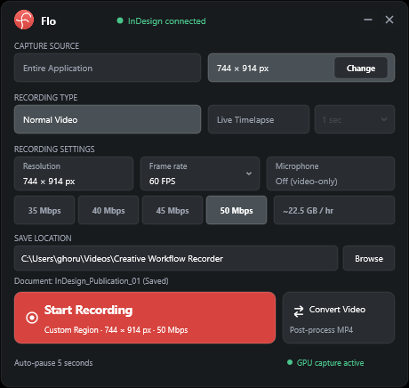
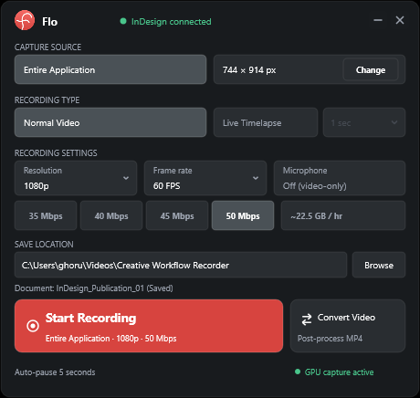
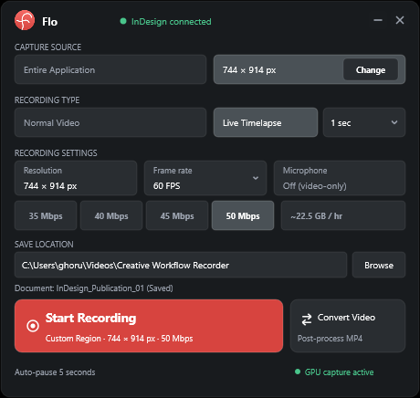

<p align="center">
  
</p>

# Flo

**A straightforward way to record your creative workflow.**

Flo is a Windows-based creative workflow recorder for Adobe Photoshop and Adobe InDesign. Capture your work, create timelapses and manage recording sessions through a compact floating interface.

[](#system-support)
[](#supported-adobe-applications)
[](#supported-adobe-applications)
[](#licensing)
[](#licensing)

---

## About Flo

Flo started from a practical frustration: recording a creative workflow could become another complicated workflow of its own.

Separate recording setups, unnecessary configuration and unwanted watermarks made it harder to capture the actual creative process.

The aim behind Flo was to make recording feel like a natural part of working inside an Adobe application.

A focused recorder, directly accessible from the creative workspace, with straightforward recording controls and clean video output.

---

## What Flo Does

- **Windows screen recording:** High-performance desktop and application video capture engineered for creative work.
- **Dedicated Photoshop and InDesign integrations:** Native plugins providing seamless workspace launch and active document tracking.
- **Entire Application capture:** Capture your complete application window including native menus, floating panels, and modal dialogs.
- **Custom Region capture:** Interactively define an arbitrary rectangular capture area with 1:1 physical pixel precision.
- **Normal Recording:** Smooth 60 FPS video capture of your real-time creative process.
- **Live Timelapse:** Condense hours of detailed creative work into concise, shareable videos with custom capture intervals.
- **H.264 MP4 output:** Universal MP4 container encoding for instant playback and video editor import.
- **GPU-accelerated capture:** Utilizes Windows Graphics Capture (WGC) and Media Foundation hardware encoders with minimal CPU impact.
- **Floating recording controls:** Compact, non-intrusive floating toolbar that sits above your workspace without stealing keyboard focus.
- **Local recording storage:** Saves recordings directly to your chosen local folder.
- **No Flo-added watermark:** Your creative work remains entirely yours—Flo never embeds branding or watermarks into exported videos.

---

## Screenshots

<p align="center">
  
  
</p>

<p align="center">
  
  
</p>

---

## Features

- **Application Recording:** Record supported Photoshop and InDesign workflows with complete capture of tools, palettes, and secondary windows.
- **Custom Region Capture:** Select a specific recording region on your canvas with its own dimensions, aspect ratio, and live DPI-scaled HUD controls.
- **Normal Recording:** Capture standard 60 FPS video of your creative process with smooth motion fidelity.
- **Live Timelapse:** Capture workflow frames at selectable intervals (250ms, 500ms, 1s, 2s, and 5s) to produce condensed workflow timelapses automatically.
- **H.264 MP4 Encoding:** High-bitrate video export supporting 35 Mbps, 40 Mbps, 45 Mbps, and 50 Mbps quality presets.
- **GPU-Accelerated Capture:** Direct3D 11 GPU pipeline and Windows Graphics Capture ensure zero UI lag during intensive brushwork or layout design.
- **Floating Recording Controls:** Manage sessions through expanded and compact toolbar modes that automatically adapt to your display scaling.
- **Audio Capture:** Optional system audio recording for commentary or background sound.
- **Local Storage:** Clean local saving directly to your personal video library.
- **No Flo Watermark:** Flo does not add any proprietary watermark, branding, or sponsor overlay to your recordings.

---

## Supported Adobe Applications

| Application | Status | Integration Type |
| :--- | :---: | :--- |
| **Adobe Photoshop** | **Available** | UXP Hybrid Addon (v24.2.0+) |
| **Adobe InDesign** | **Available** | UXP Plugin + Native Companion Bridge (v18.5.0+) |
| **Adobe Premiere Pro** | *Planned* | Future roadmap |
| **Adobe After Effects** | *Planned* | Future roadmap |
| **Adobe Illustrator** | *Planned* | Future roadmap |

*Available integrations are fully tested on Adobe 2024, 2025, and 2026 releases. Planned integrations are in active development.*

---

## System Support

- **Operating System:** Windows 10 (version 1903, 64-bit build 18362 or later) or Windows 11 (64-bit).
- **Architecture:** x64 native (or ARM64 via Windows x64 emulation).
- **Adobe Photoshop Compatibility:** Photoshop 2024 (v25.x), Photoshop 2025 (v26.x), Photoshop 2026 (v27.x and later).
- **Adobe InDesign Compatibility:** InDesign 2024 (v19.x), InDesign 2025 (v20.x), InDesign 2026 (v21.x and later).

---

## Download Flo

*One product. Choose how you want to install it.*

### Option 1 — Recommended: Unified Windows Installer

> **Label:** `Recommended`  
> **File:** `Flo_Setup.exe`

Installs both Photoshop and InDesign integrations in a single, guided setup wizard. Automatically detects supported Adobe host applications installed on your system and configures all required native components.

👉 [**Download Flo Setup (Recommended)**](https://github.com/Subho-XD/flo/releases/latest/download/Flo_Setup.exe)

---

### Option 2 — Photoshop Extension

> **File:** `Flo_Photoshop.ccx`

Install the Photoshop extension independently through Adobe's supported UXP installation method.

- **Direct Repository Download:** [`packages/2.0.1/Flo_Photoshop.ccx`](packages/2.0.1/Flo_Photoshop.ccx)
- **Latest Release Asset:** [Download Photoshop Extension](https://github.com/Subho-XD/flo/releases/latest/download/Flo_Photoshop.ccx)

---

### Option 3 — InDesign Extension

> **File:** `Flo_InDesign.ccx`

Install the InDesign extension independently.

> [!IMPORTANT]
> **Prerequisite:** The InDesign UXP plugin requires the separate **Flo Native Companion** runtime for screen recording, Direct3D compositing, and session coordination. Installing only `Flo_InDesign.ccx` is not sufficient for recording functionality.

1. First, download and run the companion installer:  
   👉 [**Download Flo InDesign Companion**](https://github.com/Subho-XD/flo/releases/latest/download/Flo_InDesign_Companion_Setup.exe)
2. Then, download and install the extension package:  
   👉 [**Download InDesign Extension**](https://github.com/Subho-XD/flo/releases/latest/download/Flo_InDesign.ccx)
- **Direct Repository Download:** [`packages/2.0.1/Flo_InDesign.ccx`](packages/2.0.1/Flo_InDesign.ccx)

---

## Installation Instructions

### Unified Installation (Recommended)
1. Download [**Flo_Setup.exe**](https://github.com/Subho-XD/flo/releases/latest/download/Flo_Setup.exe).
2. Run `Flo_Setup.exe`.
3. Accept the License Agreement.
4. Review the detected Adobe applications and confirm your choices.
5. Click **Install Flo**. The installer automatically registers the plugins with Adobe's Unified Plugin Installer Agent (UPIA) and deploys necessary background runtimes.
6. Open Photoshop or InDesign.
7. Locate Flo under the top **Plugins** menu:
   - **Photoshop:** `Plugins -> Flo`
   - **InDesign:** `Plugins -> Flo -> Open Flo`
8. Start recording your creative session.

### Photoshop-Only Installation
1. Download [**Flo_Photoshop.ccx**](https://github.com/Subho-XD/flo/releases/latest/download/Flo_Photoshop.ccx).
2. Double-click `Flo_Photoshop.ccx` to install via Adobe Creative Cloud desktop, or install using UPIA:
   ```cmd
   UnifiedPluginInstallerAgent.exe /install Flo_Photoshop.ccx
   ```
3. Open Adobe Photoshop.
4. Navigate to `Plugins -> Flo` to display the floating recording toolbar.

### InDesign-Only Installation
1. Download and run [**Flo_InDesign_Companion_Setup.exe**](https://github.com/Subho-XD/flo/releases/latest/download/Flo_InDesign_Companion_Setup.exe) to install the background companion runtime.
2. Download [**Flo_InDesign.ccx**](https://github.com/Subho-XD/flo/releases/latest/download/Flo_InDesign.ccx).
3. Double-click `Flo_InDesign.ccx` to complete UXP extension installation.
4. Launch Adobe InDesign.
5. Go to `Plugins -> Flo -> Open Flo` to connect to the companion and start recording.

---

## System Requirements

- **Operating System:** Windows 10 (version 1903+) or Windows 11 64-bit.
- **Direct3D Runtime:** Direct3D 11 runtime is included natively with all modern Windows editions. No separate DirectX 11 or DirectX 12 download is required.
- **Graphics Capture:** Windows Graphics Capture (WGC) API support (standard in Windows 10 build 18362+ and Windows 11).
- **GPU & Hardware Encoder:** Direct3D 11-capable GPU supporting hardware H.264 video encoding (NVIDIA NVENC, Intel Quick Sync, or AMD AMF/VCE).
- **Microsoft Visual C++ Runtime:** Requires standard Visual C++ x64 runtime components (`vcruntime140.dll`). If missing, install the official Microsoft Visual C++ 2015–2022 Redistributable.
- **Windows N Editions Note:** If using a Windows N edition, media foundation components are not pre-installed. Install the free Windows Media Feature Pack via `Windows Settings -> System -> Optional features`.

---

## Recording Storage

Flo is engineered with a local-first philosophy. All video recordings are saved locally on your computer in your personal video directory:

```text
%USERPROFILE%\Videos\Creative Workflow Recorder\
```

Recordings are saved as high-quality MP4 video files timestamped by date and time (`Creative_Recorder_YYYYMMDD_HHMMSS.mp4`). You can play them in any media player or drop them directly into Adobe Premiere Pro or After Effects.

---

## Licensing

Flo is proprietary software distributed by Subho Ghorui.

- **No Subscription:** Flo is distributed without a subscription or recurring payment.
- **Personal and Business Use:** Users may use Flo for personal creative workflows and internal business workflows.
- **Commercial Rights to Output:** You retain complete ownership of all videos recorded with Flo. You are free to edit, publish, monetize, and commercially distribute your recordings.
- **Redistribution Prohibited:** Flo is proprietary. Users may not sell, resell, sublicense, rent, repackage, reverse engineer, or redistribute Flo or its components.
- **Not Open Source:** This repository is an official product distribution platform; it does not grant source-code rights or an open-source license.
- **Governing Terms:** Use of Flo is subject to the [Flo EULA](EULA.txt).

---

## Support

- **Publisher:** Subho Ghorui
- **Email:** [ghoruisubho1999@gmail.com](mailto:ghoruisubho1999@gmail.com)
- **Issue Tracker:** [GitHub Issues](https://github.com/Subho-XD/flo/issues)

---

## Future Roadmap

- [x] Adobe Photoshop Integration (Available)
- [x] Adobe InDesign Integration (Available)
- [ ] Adobe Premiere Pro Integration (*Planned*)
- [ ] Adobe After Effects Integration (*Planned*)
- [ ] Adobe Illustrator Integration (*Planned*)
